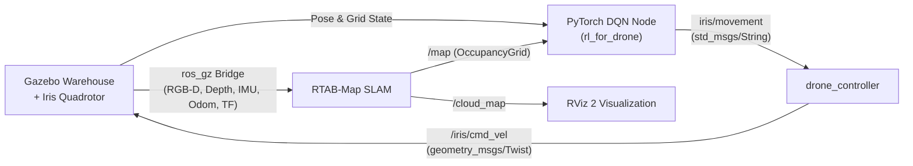

# Autonomous UAV Simulation for Search and Rescue (ROS 2, Gazebo & DQN)

[](#architecture--runtime-data-flow)
[](#project-results)
[](#mapping-and-sensor-pipeline)
[](#dqn-reinforcement-learning-prototype)
[](#architecture--runtime-data-flow)

> **A simulated indoor search-and-rescue UAV testbed** integrating an **Iris quadrotor in Gazebo**, **ROS 2 sensor bridging**, **RTAB-Map 3D/2D SLAM**, **RViz 2 point-cloud visualization**, and a **PyTorch Deep Q-Network (DQN)** prototype for discrete navigation control.

> **Portfolio Scope Note:** This public repository presents the system architecture, ROS 2 interfaces, and simulation/training evidence. The private implementation packages remain in a separate repository, and the RL navigation module is documented below as an experimental prototype.

---

## Key Engineering Highlights

- **Multi-Package ROS 2 Architecture:** Modular separation across simulation launch/bridging (`launch_world`), velocity actuation (`drone_controller`), reinforcement learning (`rl_for_drone`), and 3D world/URDF assets (`working_model_5`).
- **Real-Time Sensor Bridging & SLAM:** Bridges Gazebo RGB-D camera, depth, point cloud, IMU, odometry, and TF transforms into **RTAB-Map** to generate 3D point clouds (`/cloud_map`) and 2D occupancy grids (`/map`).
- **PyTorch DQN Action-Selection Prototype:** Implements a neural Q-network over a `128 × 128` local map crop (`16,384` state inputs) with epsilon-greedy exploration, a `5,000`-transition replay buffer, mini-batch updates (`64`), and target-network synchronization.
- **Velocity Control Abstraction:** Translates high-level discrete RL actions (`up`, `down`, `turn_right`, `turn_left`, `forward`) on `iris/movement` into timed `geometry_msgs/Twist` commands on `/iris/cmd_vel`.

---

## Project Results

### 1. RViz Point-Cloud & SLAM Visualization
The configured RViz 2 workspace visualizes the 3D SLAM point cloud (`/cloud_map`) generated by RTAB-Map in the `map` fixed frame as the Iris UAV explores the warehouse environment.


### 2. DQN Optimization Loss
The training pipeline logs Q-value optimization loss across episodes. The project report records a Mean Squared Error (MSE) of **0.09** *(note: this reflects Q-value Bellman error during training rather than end-to-end navigation or map accuracy)*.


### 3. Gazebo Warehouse Simulation Recording
[▶ View the Gazebo simulation recording](output/Screencast%20from%202025-04-15%2015-53-31.mp4)

---

## Architecture & Runtime Data Flow



### Package & Asset Structure

| Component | Responsibility |
| :--- | :--- |
| `launch_world` | Launches Gazebo, spawns the Iris quadrotor, starts `ros_gz` bridges, RViz 2, RTAB-Map, and the robot-state publisher. |
| `drone_controller` | Converts discrete movement commands into timed `Twist` velocity commands followed by zero-velocity stops. |
| `rl_for_drone` | Houses the PyTorch DQN architecture, experience replay training loop (`rl_for_drone_1`), environment wrapper, and inference script (`DQN_Prediction.py`). |
| `working_model_5` | Contains the indoor warehouse world (`drone_simulation.world`), Iris URDF/meshes, and RViz configuration. |
| `output` | Stores simulation screenshots, training loss plots, and the Gazebo screencast referenced in this README. |

### ROS 2 Interfaces

| Topic / Interface | Message Type | Role |
| :--- | :--- | :--- |
| `/map` | `nav_msgs/OccupancyGrid` | 2D SLAM occupancy grid used as the local state input for the DQN environment. |
| `/cloud_map` | Point Cloud | 3D SLAM point-cloud stream visualized in RViz 2 (`map` fixed frame). |
| `/world/world_demo/pose/info` | `geometry_msgs/PoseArray` | Ground-truth simulation pose consumed by the environment wrapper. |
| `iris/movement` | `std_msgs/String` | Discrete navigation command published by the DQN node to `drone_controller`. |
| `/iris/cmd_vel` | `geometry_msgs/Twist` | Actuation velocity command bridged from `drone_controller` to Gazebo. |
| `/camera1/*`, `/camera2/*`, `/tf`, `/odom` | Sensor & Transform Topics | RGB-D perception, odometry, and TF trees bridged from Gazebo for SLAM and visualization. |
| `/imu` | `sensor_msgs/Imu` | Bridged inertial stream (available on topic; not yet fused into the DQN state vector). |

---

## Mapping and Sensor Pipeline

The simulated Iris UAV carries an **RGB-D camera** and an **IMU**:
- **RGB-D Camera:** Supplies color and depth streams to **RTAB-Map** for visual-inertial SLAM and obstacle geometry extraction.
- **IMU:** Provides inertial measurements alongside odometry; tuning IMU calibration/fusion was identified as a key factor in improving map consistency.
- **RTAB-Map & RViz 2:** Produces both a 3D point-cloud map (`/cloud_map`) and a 2D occupancy grid (`/map`) for downstream planning.

---

## DQN Reinforcement-Learning Prototype

- **State Representation:** Local `128 × 128` occupancy-grid patch (`16,384` values) centered on the UAV's current position.
- **Network & Action Space:** Fully connected PyTorch MLP with ReLU hidden layers predicting 5 Q-values for discrete actions: `up`, `down`, `turn_right`, `turn_left`, and `forward`.
- **Training Configuration:**
  - Replay buffer capacity: `5,000` transitions · Mini-batch size: `64`
  - Discount factor ($\gamma$): `0.99` · Optimizer: **Adam** · Policy: $\epsilon$-greedy
  - Target network synced at episode boundaries across up to `1,000` episodes (`200` steps/episode)

---

## Reference Execution Workflow (Private Workspace)

In the full Linux ROS 2 environment (ROS 2 + Gazebo Sim `ros_gz` + RViz 2 + RTAB-Map + `torch`, `numpy`, `matplotlib`), the system runs across two terminals after configuring local paths in `world_launch.py`, `drone_simulation.world`, and `iris.urdf`:

```bash
# Terminal 1: Build workspace and launch Gazebo, bridges, RTAB-Map, controller, and RViz 2
source /opt/ros/$ROS_DISTRO/setup.bash
colcon build && source install/setup.bash
ros2 launch launch_world world_launch.py

# Terminal 2: Launch the DQN training loop
source /opt/ros/$ROS_DISTRO/setup.bash
source install/setup.bash
ros2 run rl_for_drone rl_for_drone_1
```

---

## Current Prototype Scope & Next Engineering Milestones

This codebase was built as a **research and simulation prototype** demonstrating ROS 2, SLAM, and RL integration. A technical audit of the snapshot identifies the following concrete milestones to bring it to reproducible autonomous navigation:

1. **Episode Reset & Collision Feedback:** Implement Gazebo world/UAV `reset()` between episodes and wire the contact-sensor subscription to provide reliable terminal collision signals and terminal-state Q-target masking.
2. **ROS 2 Executor & State Alignment:** Ensure active `rclpy` node spinning inside the RL training/inference loops, verify full occupancy-grid array indexing in the `/map` callback, and register `DQN_Prediction.py` as a formal ROS 2 entry point.
3. **Reward Shaping & Sensor Fusion:** Replace map-cell-change rewards with a goal-directed + obstacle-clearance reward function, fuse IMU/depth features into the RL state, and address IMU drift in RTAB-Map.
4. **Portability & Benchmarking:** Parameterize local asset URIs and model weight paths, pin ROS 2/Gazebo package versions, and log quantitative navigation metrics (success rate, path length, collision rate) alongside Q-loss.
